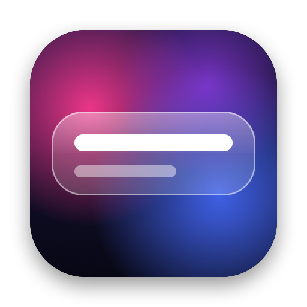
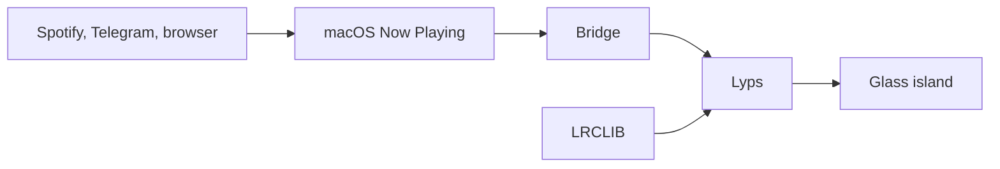

<p align="center">
  
</p>

<h1 align="center">Lyps</h1>

<p align="center">
  Synced lyrics in a small Liquid Glass island, floating above whatever you're doing.
</p>

<p align="center">
  
  
  
</p>

Play a song in Spotify or Telegram and Lyps shows the current line, with the next one beneath it. It never takes focus from the app you're using, and it gets out of the way when the music stops.

## Features

- **Real Liquid Glass.** Uses Apple's native `glassEffect`, lightly tinted with the song's artwork.
- **Synced line by line.** Each line slides up into place as it's sung.
- **Works across players.** Spotify and Telegram Desktop are on by default, and browsers such as YouTube are one switch away.
- **Fix the timing yourself.** Lyrics running early or late? Nudge them, and Lyps remembers that for the song.
- **Everything is switchable.** Always-on-top, auto-show, artwork, next line, each source and every shortcut.
- **Small and quiet.** A menu bar app with no Dock icon. It wakes only when the next line is due instead of polling.
- **Right-to-left aware.** Persian, Arabic and Hebrew lines align to the right.

## Shortcuts

| Action | Default |
|---|---|
| Show or hide lyrics | `⌥L` |
| Turn Lyps on or off | `⌃⇧⌘L` |
| Show lyrics earlier (0.25s) | `⌥[` |
| Show lyrics later (0.25s) | `⌥]` |

You can change any of these in Settings. While Lyps is running, these key combinations no longer type their usual characters, so rebind them if you use those characters.

## Install

There's no prebuilt download yet, so you build it yourself. It takes a few minutes and needs no Xcode or Apple Developer account.

**You'll need** macOS 26 or later, the Command Line Tools, and CMake:

```bash
xcode-select --install
```

```bash
brew install cmake
```

**Then build and open it:**

```bash
git clone https://github.com/ausdavoud/lyps.git && cd lyps && zsh scripts/bundle.sh
```

```bash
open build/Lyps.app
```

Look for the music note icon in your menu bar. To keep the app, drag `build/Lyps.app` into Applications.

## How it works



1. **Reading what's playing.** Since macOS 15.4, third-party apps can't read Now Playing directly. Lyps uses [mediaremote-adapter](https://github.com/ungive/mediaremote-adapter), which reaches it through the system's `perl`. The build script downloads a pinned version.
2. **Finding lyrics.** Lyps asks [LRCLIB](https://lrclib.net), a free community lyrics database, then caches the result on your Mac. Search results must match the title, plus the duration or artist, because wrong lyrics are worse than none.
3. **Staying in time.** Lyps works out the position from what the player last reported and schedules the next line.

## Privacy

- **What's sent:** the title, artist, album and duration of playing songs go to LRCLIB to find lyrics. Nothing else leaves your Mac, and there's no account or analytics.
- **Telegram voice messages:** Telegram reports these as now playing, using the date as the title and the sender as the artist. Lyps recognizes that pattern and never looks them up. A song with a clock time in its title, like "12:51", gets no lyrics as a result.
- **Browsers:** this source is off by default because it would send the title of every video that plays.

## Known limitations

- **It depends on a workaround.** A macOS update could block the Now Playing bridge. Lyps would then show a warning in its menu until the bridge catches up.
- **Lyric quality varies.** Timings are submitted by volunteers, so some are off, and the nudge shifts a whole song rather than a single verse. Coverage is thinner for less mainstream music, and Telegram files with poor tags match less often.
- **Songs without synced lyrics** show their name briefly, then the island hides.
- **Mac only for now.** It isn't on the App Store, because the bridge isn't allowed in the sandbox. Sharing a build with others would need notarization, or they'd have to approve it under Privacy & Security.

## Development

```bash
zsh scripts/test.sh
```

Use this instead of plain `swift test`, which can lose track of its macro plugin when Xcode isn't installed.

To try the UI without a player, this plays a scripted timeline, including a simulated Telegram voice message:

```bash
swift build && LYPS_BRIDGE="python3 scripts/fake-bridge.py" "$(swift build --show-bin-path)/Lyps"
```

The icon is drawn in code, by [scripts/make-icon.swift](scripts/make-icon.swift).

## Credits

- Created by [Davoud Nosrati](https://github.com/ausdavoud), built with [Claude](https://claude.com/claude-code) as a contributor.
- [LRCLIB](https://lrclib.net) for the lyrics, and [mediaremote-adapter](https://github.com/ungive/mediaremote-adapter) (BSD-3-Clause) for the Now Playing bridge.
- The island's look was inspired by [Ava](https://github.com/yappologistic/Ava). No code or assets were used.
