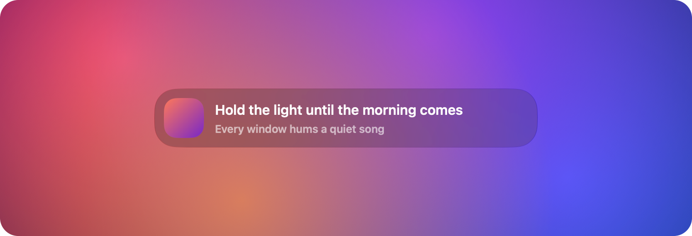
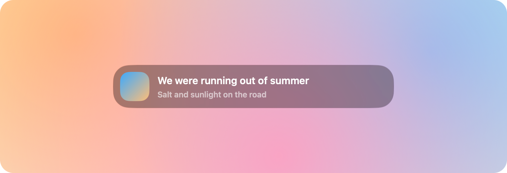
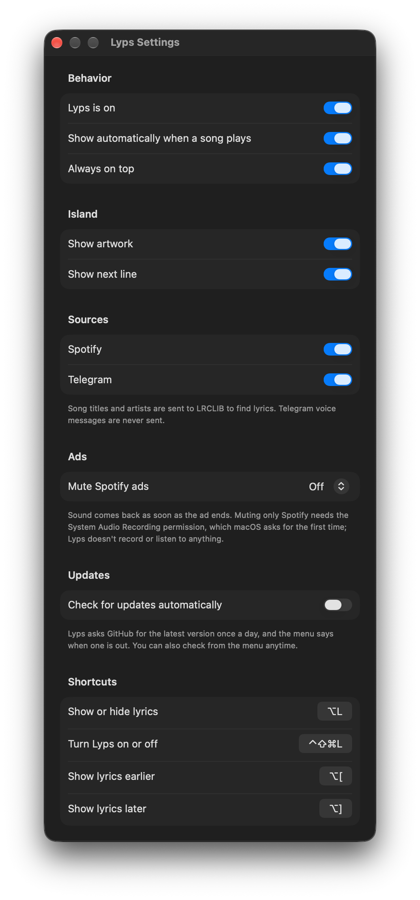
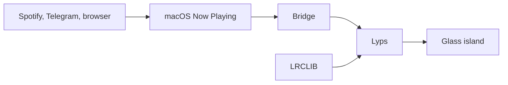

<p align="center">
  
</p>

<h1 align="center">Lyps</h1>

<p align="center">
  Synced lyrics in a small Liquid Glass island, floating above whatever you're doing.
</p>

<p align="center">
  <a href="https://github.com/ausdavoud/lyps/releases/latest"></a>
  
  
</p>

<p align="center">
  
</p>

Play a song in Spotify or Telegram and Lyps shows the current line, with the next one beneath it. It never takes focus from the app you're using, and it gets out of the way when the music stops.

<table>
  <tr>
    <td></td>
    <td></td>
  </tr>
  <tr>
    <td align="center">Readable on bright wallpapers</td>
    <td align="center">Right-to-left lyrics</td>
  </tr>
</table>

<sub>Real captures of the app. The wallpapers are generated, and the lyrics are placeholder lines written for these screenshots.</sub>

## Features

- **Real Liquid Glass.** Uses Apple's native `glassEffect`, lightly tinted with the song's artwork.
- **Synced line by line.** Each line slides up into place as it's sung.
- **Works across players.** Spotify and Telegram Desktop are on by default, and browsers such as YouTube are one switch away.
- **Fix the timing yourself.** Lyrics running early or late? Nudge them, and Lyps remembers that for the song.
- **Everything is switchable.** Always-on-top, auto-show, artwork, next line, each source and every shortcut.
- **Small and quiet.** A menu bar app with no Dock icon. It wakes only when the next line is due instead of polling.
- **Right-to-left aware.** Persian, Arabic and Hebrew lines align to the right.

## Download

**[Download the latest Lyps.dmg](https://github.com/ausdavoud/lyps/releases/latest)**. It needs macOS 26 or later.

Lyps is free and isn't notarized by Apple, which requires a paid developer account. macOS will block it the first time, so you approve it once in System Settings:

1. Open the DMG and **drag Lyps into Applications**. Do this before opening it, or Lyps can't read what's playing.
2. Open Lyps from Applications. macOS says it can't verify the app. Click **Done**, not Move to Trash.
3. Open **System Settings → Privacy & Security** and scroll down to the **Security** section.
4. Next to the message about Lyps, click **Open Anyway**, then confirm with your password or Touch ID.

Look for the music note icon in your menu bar, then play a song. You won't be asked again.

To check your download first, compare `shasum -a 256 Lyps-*.dmg` with the checksum on the release page. If you'd rather not bypass the warning at all, [build it yourself](#build-from-source).

## Settings and privacy

**Lyps asks for no special permissions.** You won't need to allow it under Accessibility, Input Monitoring, Screen Recording, Automation or Microphone, and it can't read your screen or your keystrokes. Its shortcuts use a system API that only reports the key combinations it registered. After a Telegram voice message, it checks whether Telegram is producing sound, which tells it nothing about what the sound is.

**What leaves your Mac:** the title, artist, album and duration of playing songs go to [LRCLIB](https://lrclib.net) to find lyrics. There's no account or analytics.

**What stays on your Mac:** lyrics are cached in `~/Library/Caches/Lyps`, and your settings and timing nudges are saved in your preferences.

| Source | Default | What to know |
|---|---|---|
| Spotify | On | |
| Telegram | On | Voice messages are never looked up. Telegram reports them with the date as the title and the sender as the artist, so Lyps skips anything shaped like that. A song with a clock time in its title, like "12:51", gets no lyrics as a result. |
| Browsers (YouTube) | Off | When on, the title of any video that plays is sent to LRCLIB. |

You can turn each source off in Settings. Turning Lyps off stops it reading Now Playing and sending anything.

<p align="center">
  
</p>

## Shortcuts

| Action | Default |
|---|---|
| Show or hide lyrics | `⌥L` |
| Turn Lyps on or off | `⌃⇧⌘L` |
| Show lyrics earlier (0.25s) | `⌥[` |
| Show lyrics later (0.25s) | `⌥]` |

You can change any of these in Settings. While Lyps is running, these key combinations no longer type their usual characters, so rebind them if you use those characters.

## How it works



1. **Reading what's playing.** Since macOS 15.4, third-party apps can't read Now Playing directly. Lyps uses [mediaremote-adapter](https://github.com/ungive/mediaremote-adapter), which reaches it through the system's `perl`.
2. **Finding lyrics.** Lyps asks LRCLIB, a free community lyrics database, and caches the result. Search results must match the title, plus the duration or artist, because wrong lyrics are worse than none.
3. **Staying in time.** Lyps works out the position from what the player last reported and schedules the next line.

## Known limitations

- **It depends on a workaround.** A macOS update could block the Now Playing bridge. Lyps would then show a warning in its menu until the bridge catches up.
- **Lyric quality varies.** Timings are submitted by volunteers, so some are off, and the nudge shifts a whole song rather than a single verse. Coverage is thinner for less mainstream music, and Telegram files with poor tags match less often.
- **Songs without synced lyrics** show their name briefly, then the island hides.
- **Telegram after a voice message.** Telegram resumes the song but stops reporting it to macOS. Lyps keeps the lyrics going from where the song paused, using Telegram's sound to follow pause and play. Seeking in that state isn't tracked until the next track.
- **Mac only for now.** It can't be on the App Store, because the bridge isn't allowed in the sandbox. Builds include Apple Silicon and Intel, but only Apple Silicon has been tested.

## Build from source

You'll need macOS 26 or later, the Command Line Tools and CMake. Xcode isn't required. The build script downloads a pinned version of the bridge.

```bash
xcode-select --install
```

```bash
brew install cmake
```

```bash
git clone https://github.com/ausdavoud/lyps.git && cd lyps && zsh scripts/bundle.sh
```

```bash
open build/Lyps.app
```

## Development

```bash
zsh scripts/test.sh
```

Use this instead of plain `swift test`, which can lose track of its macro plugin when Xcode isn't installed.

To try the UI without a player, this plays a scripted timeline, including a simulated Telegram voice message:

```bash
swift build && LYPS_BRIDGE="python3 scripts/fake-bridge.py" "$(swift build --show-bin-path)/Lyps"
```

`scripts/release.sh` builds the DMG, and [scripts/make-icon.swift](scripts/make-icon.swift) draws the icon.

## Credits

- Created by [Davoud Nosrati](https://github.com/ausdavoud), built with [Claude](https://claude.com/claude-code) as a contributor.
- [LRCLIB](https://lrclib.net) for the lyrics, and [mediaremote-adapter](https://github.com/ungive/mediaremote-adapter) (BSD-3-Clause) for the Now Playing bridge. Its license ships inside the app.
- The island's look was inspired by [Ava](https://github.com/yappologistic/Ava). No code or assets were used.

## License

[MIT](LICENSE)
